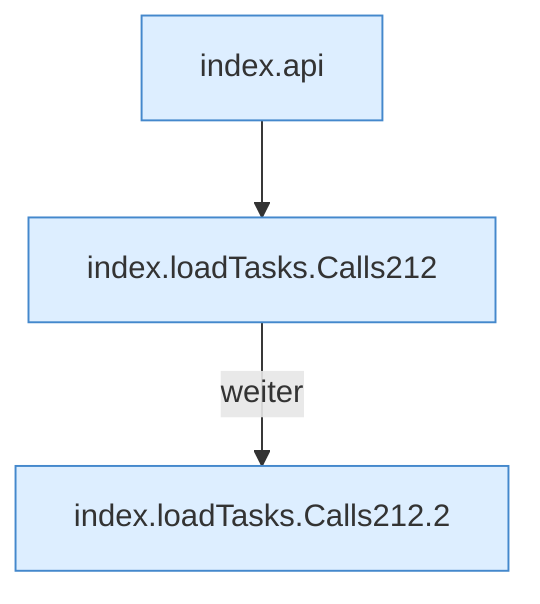

[[00 Start]] › [[Dashboard-UI]] › [[Legacy-Altlast]] › [[index.loadTasks]]

# index.loadTasks

`index.loadTasks()` [src/main/resources/web/index.html:212–212](https://github.com/Sciddie/minecraft-serverhoster-plugin/blob/95b02b953b0b4c23673e900e021a7c3c844aa37d/src/main/resources/web/index.html#L212-L212)



```knoten
index.api
  Schickt von der älteren [[Glossar#Bedienseite|Bedienseite]] eine Anfrage an die [[Glossar#Web-Schnittstelle|Web-Schnittstelle]]. Im [[Glossar#Quelltext|Quelltext]] heißt das `api`.
index.loadTasks.Calls212
  Weitere [[Glossar#Funktion|Funktionen]], die ab [[Glossar#Zeile|Zeile]] 212 aufgerufen werden. Im [[Glossar#Quelltext|Quelltext]] heißt das `Calls212`.
index.loadTasks.Calls212.2
  Ein [[Glossar#Kapitel|Kapitel]] in dieser Übersicht. Im [[Glossar#Quelltext|Quelltext]] heißt das `2`.
```

> [!knoten]- Was die Blöcke tun
> - **index.api**: Schickt von der älteren [[Glossar#Bedienseite|Bedienseite]] eine Anfrage an die [[Glossar#Web-Schnittstelle|Web-Schnittstelle]]. Im [[Glossar#Quelltext|Quelltext]] heißt das `api`.
> - **index.loadTasks.Calls212**: Weitere [[Glossar#Funktion|Funktionen]], die ab [[Glossar#Zeile|Zeile]] 212 aufgerufen werden. Im [[Glossar#Quelltext|Quelltext]] heißt das `Calls212`.
> - **index.loadTasks.Calls212.2**: Ein [[Glossar#Kapitel|Kapitel]] in dieser Übersicht. Im [[Glossar#Quelltext|Quelltext]] heißt das `2`.

- Die ältere [[Glossar#Bedienseite|Bedienseite]] lädt die [[Glossar#Aufgabe|Aufgaben]].
