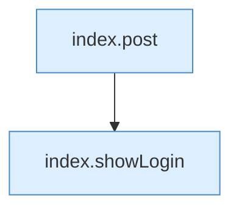

[[00 Start]] › [[Dashboard-UI]] › [[Legacy-Sitzung]] › [[index.logout]]

# index.logout

`index.logout()` [src/main/resources/web/index.html:87–87](https://github.com/Sciddie/minecraft-serverhoster-plugin/blob/95b02b953b0b4c23673e900e021a7c3c844aa37d/src/main/resources/web/index.html#L87-L87)



```knoten
index.post
  Schickt von der älteren [[Glossar#Bedienseite|Bedienseite]] einen Auftrag, der etwas ändert. Im [[Glossar#Quelltext|Quelltext]] heißt das `post`.
index.showLogin
  Die ältere [[Glossar#Bedienseite|Bedienseite]] zeigt die [[Glossar#Anmeldung|Anmeldung]]. Im [[Glossar#Quelltext|Quelltext]] heißt das `showLogin`.
```

> [!knoten]- Was die Blöcke tun
> - **index.post**: Schickt von der älteren [[Glossar#Bedienseite|Bedienseite]] einen Auftrag, der etwas ändert. Im [[Glossar#Quelltext|Quelltext]] heißt das `post`.
> - **index.showLogin**: Die ältere [[Glossar#Bedienseite|Bedienseite]] zeigt die [[Glossar#Anmeldung|Anmeldung]]. Im [[Glossar#Quelltext|Quelltext]] heißt das `showLogin`.

- Meldet von der älteren [[Glossar#Bedienseite|Bedienseite]] ab.
