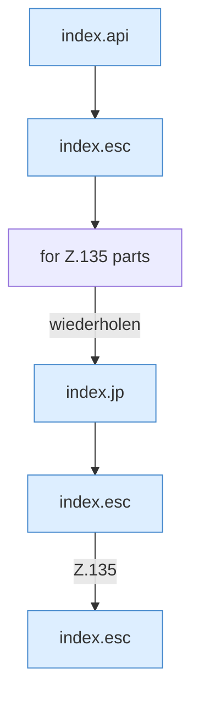

[[00 Start]] › [[Dashboard-UI]] › [[Legacy-Dateien]] › [[index.ls]] › [[index.ls.Teil1]]

# index.ls.Teil1



```knoten
index.api
  Sendet einen Dashboard-Request `api`. Ruft `scoped`, `showLogin`, `toast`.
index.esc
  Maskiert HTML `esc`.
for Z.135 parts
  Zeile 135: Schleife `parts`.
index.jp
  Baut einen Pfad `jp`.
```

- Fortsetzung von `index.ls`, Quellreihenfolge.
