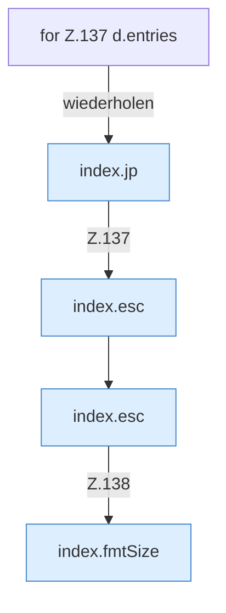

[[00 Start]] › [[Dashboard-UI]] › [[Legacy-Dateien]] › [[index.ls]] › [[index.ls.Teil2.Z137]]

# index.ls.Teil2.Z137



```knoten
for Z.137 d.entries
  Zeile 137: Schleife `d.entries`.
index.jp
  Baut in der älteren [[Glossar#Bedienseite|Bedienseite]] einen Dateipfad aus seinen Teilen. Baut einen Pfad `jp`.
index.esc
  Macht einen Text so ungefährlich, dass die Seite ihn anzeigen kann. Maskiert HTML `esc`.
index.fmtSize
  Die ältere [[Glossar#Bedienseite|Bedienseite]] macht lesbar die Größe. Formatiert `fmtSize`.
```

> [!knoten]- Was die Blöcke tun
> - **for Z.137 d.entries**: Zeile 137: Schleife `d.entries`.
> - **index.jp**: Baut in der älteren [[Glossar#Bedienseite|Bedienseite]] einen Dateipfad aus seinen Teilen. Baut einen Pfad `jp`.
> - **index.esc**: Macht einen Text so ungefährlich, dass die Seite ihn anzeigen kann. Maskiert HTML `esc`.
> - **index.fmtSize**: Die ältere [[Glossar#Bedienseite|Bedienseite]] macht lesbar die Größe. Formatiert `fmtSize`.

- Der Ablauf geht in [[Glossar#Zeile|Zeile]] 137 weiter. Eine Ebene tiefer steht er genauer.
- Fortsetzung von `index.ls.Teil2`.
