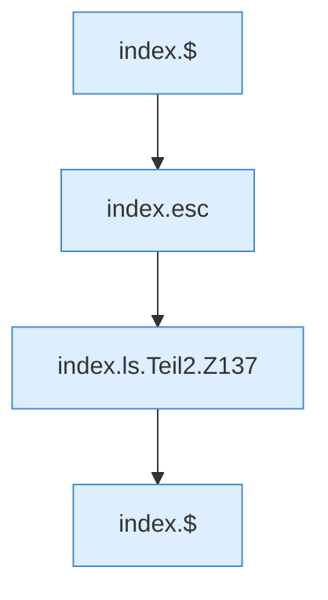

[[00 Start]] › [[Dashboard-UI]] › [[Legacy-Dateien]] › [[index.ls]] › [[index.ls.Teil2]]

# index.ls.Teil2



```knoten
index.$
  `$` in `index.html`.
index.esc
  Maskiert HTML `esc`.
index.ls.Teil2.Z137
  Fortsetzung des Ablaufs ab Zeile 137.
```

- Fortsetzung von `index.ls`, Quellreihenfolge.
