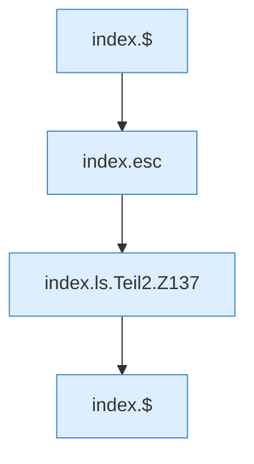

[[00 Start]] › [[Dashboard-UI]] › [[Legacy-Dateien]] › [[index.ls]] › [[index.ls.Teil2]]

# index.ls.Teil2



```knoten
index.$
  Sucht auf der älteren [[Glossar#Bedienseite|Bedienseite]] ein einzelnes Element. `$` in `index.html`.
index.esc
  Macht einen Text so ungefährlich, dass die Seite ihn anzeigen kann. Maskiert HTML `esc`.
index.ls.Teil2.Z137
  Der Ablauf geht in [[Glossar#Zeile|Zeile]] 137 weiter. Eine Ebene tiefer steht er genauer. Fortsetzung des Ablaufs ab Zeile 137.
```

> [!knoten]- Was die Blöcke tun
> - **index.$**: Sucht auf der älteren [[Glossar#Bedienseite|Bedienseite]] ein einzelnes Element. `$` in `index.html`.
> - **index.esc**: Macht einen Text so ungefährlich, dass die Seite ihn anzeigen kann. Maskiert HTML `esc`.
> - **index.ls.Teil2.Z137**: Der Ablauf geht in [[Glossar#Zeile|Zeile]] 137 weiter. Eine Ebene tiefer steht er genauer. Fortsetzung des Ablaufs ab Zeile 137.

- Ein weiterer Abschnitt derselben Übersicht.
- Fortsetzung von `index.ls`.
