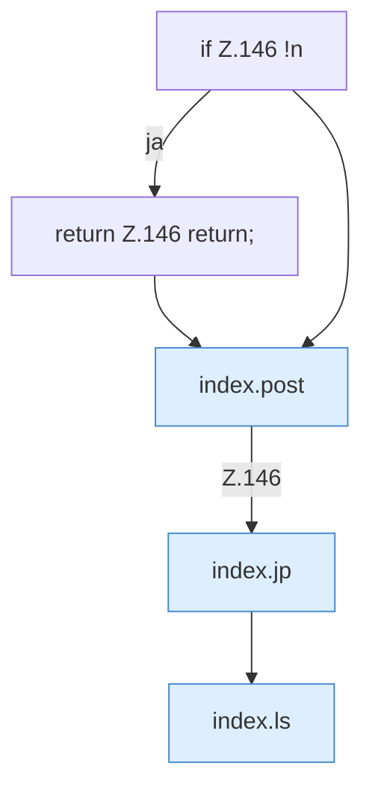

[[00 Start]] › [[Dashboard-UI]] › [[Legacy-Dateien]] › [[index.mkdir]]

# index.mkdir

`index.mkdir()` [src/main/resources/web/index.html:146–146](https://github.com/Sciddie/minecraft-serverhoster-plugin/blob/95b02b953b0b4c23673e900e021a7c3c844aa37d/src/main/resources/web/index.html#L146-L146)



```knoten
if Z.146 !n
  Zeile 146: prüft `!n`.
return Z.146 return;
  Zeile 146: Rückgabe `return;`.
index.post
  Sendet POST `post`. Ruft `api`.
index.jp
  Baut einen Pfad `jp`.
index.ls
  Listet das Verzeichnis `ls`. Ruft `api`, `esc`, `jp`.
```

- `mkdir` in `src/main/resources/web/index.html`
