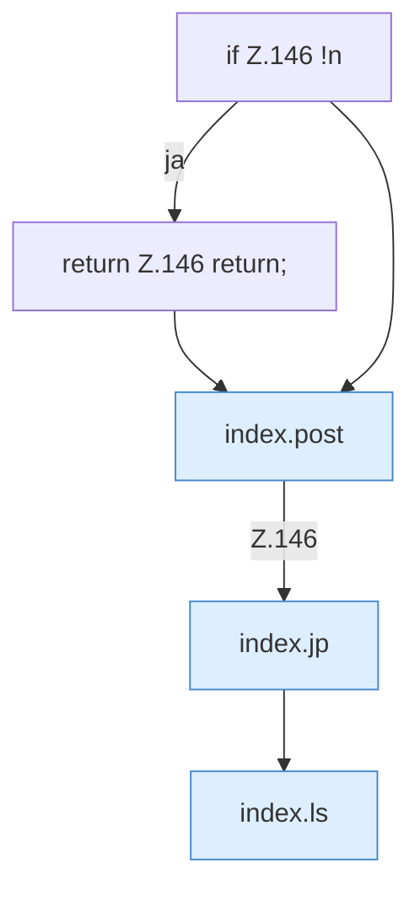

[[00 Start]] › [[Dashboard-UI]] › [[Legacy-Dateien]] › [[index.mkdir]]

# index.mkdir

`index.mkdir()` [src/main/resources/web/index.html:146–146](https://github.com/Sciddie/minecraft-serverhoster-plugin/blob/95b02b953b0b4c23673e900e021a7c3c844aa37d/src/main/resources/web/index.html#L146-L146)



```knoten
if Z.146 !n
  Hier fällt eine Entscheidung. Nur wenn sie zutrifft, geht es den Ja-Weg weiter. Das steht in [[Glossar#Zeile|Zeile]] 146.
return Z.146 return;
  Hier endet die [[Glossar#Funktion|Funktion]] und liefert ein Ergebnis zurück. Das steht in [[Glossar#Zeile|Zeile]] 146.
index.post
  Schickt von der älteren [[Glossar#Bedienseite|Bedienseite]] einen Auftrag, der etwas ändert. Im [[Glossar#Quelltext|Quelltext]] heißt das `post`.
index.jp
  Baut in der älteren [[Glossar#Bedienseite|Bedienseite]] einen Dateipfad aus seinen Teilen. Im [[Glossar#Quelltext|Quelltext]] heißt das `jp`.
index.ls
  Zeigt in der älteren [[Glossar#Bedienseite|Bedienseite]] den Inhalt eines Ordners. Im [[Glossar#Quelltext|Quelltext]] heißt das `ls`.
```

> [!knoten]- Was die Blöcke tun
> - **if Z.146 !n**: Hier fällt eine Entscheidung. Nur wenn sie zutrifft, geht es den Ja-Weg weiter. Das steht in [[Glossar#Zeile|Zeile]] 146.
> - **return Z.146 return;**: Hier endet die [[Glossar#Funktion|Funktion]] und liefert ein Ergebnis zurück. Das steht in [[Glossar#Zeile|Zeile]] 146.
> - **index.post**: Schickt von der älteren [[Glossar#Bedienseite|Bedienseite]] einen Auftrag, der etwas ändert. Im [[Glossar#Quelltext|Quelltext]] heißt das `post`.
> - **index.jp**: Baut in der älteren [[Glossar#Bedienseite|Bedienseite]] einen Dateipfad aus seinen Teilen. Im [[Glossar#Quelltext|Quelltext]] heißt das `jp`.
> - **index.ls**: Zeigt in der älteren [[Glossar#Bedienseite|Bedienseite]] den Inhalt eines Ordners. Im [[Glossar#Quelltext|Quelltext]] heißt das `ls`.

- Legt in der älteren [[Glossar#Bedienseite|Bedienseite]] einen Ordner an.
