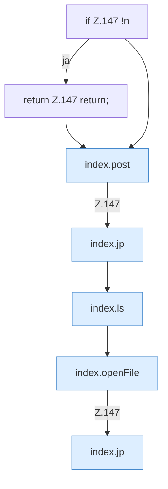

[[00 Start]] › [[Dashboard-UI]] › [[Legacy-Dateien]] › [[index.newFile]]

# index.newFile

`index.newFile()` [src/main/resources/web/index.html:147–147](https://github.com/Sciddie/minecraft-serverhoster-plugin/blob/95b02b953b0b4c23673e900e021a7c3c844aa37d/src/main/resources/web/index.html#L147-L147)



```knoten
if Z.147 !n
  Zeile 147: prüft `!n`.
return Z.147 return;
  Zeile 147: Rückgabe `return;`.
index.post
  Sendet POST `post`. Ruft `api`.
index.jp
  Baut einen Pfad `jp`.
index.ls
  Listet das Verzeichnis `ls`. Ruft `api`, `esc`, `jp`.
index.openFile
  Öffnet `openFile`. Ruft `api`, `$`.
```

- `newFile` in `src/main/resources/web/index.html`
