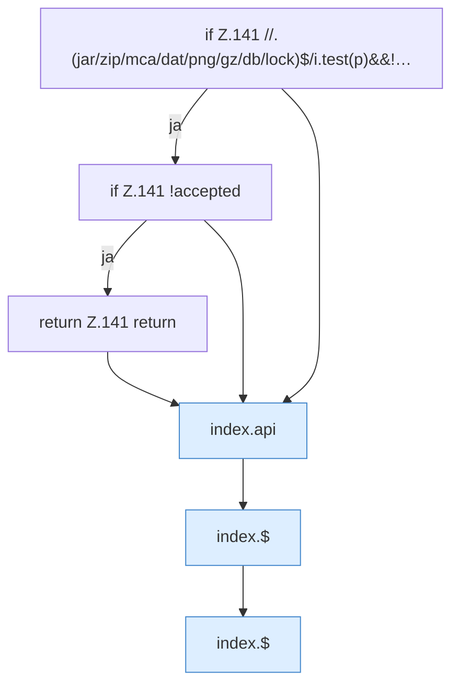

[[00 Start]] › [[Dashboard-UI]] › [[Legacy-Dateien]] › [[index.openFile]] › [[index.openFile.Teil1]]

# index.openFile.Teil1



```knoten
if Z.141 //.(jar/zip/mca/dat/png/gz/db/lock)$/i.test(p)&&!…
  Zeile 141: prüft `//.(jar/zip/mca/dat/png/gz/db/lock)$/i.test(p)&&!…`.
if Z.141 !accepted
  Zeile 141: prüft `!accepted`.
return Z.141 return
  Zeile 141: Rückgabe `return`.
index.api
  Schickt von der älteren [[Glossar#Bedienseite|Bedienseite]] eine Anfrage an die [[Glossar#Web-Schnittstelle|Web-Schnittstelle]]. Sendet einen Dashboard-Request `api`. Ruft `scoped`, `showLogin`, `toast`.
index.$
  Sucht auf der älteren [[Glossar#Bedienseite|Bedienseite]] ein einzelnes Element. `$` in `index.html`.
```

> [!knoten]- Was die Blöcke tun
> - **if Z.141 //.(jar/zip/mca/dat/png/gz/db/lock)$/i.test(p)&&!…**: Zeile 141: prüft `//.(jar/zip/mca/dat/png/gz/db/lock)$/i.test(p)&&!…`.
> - **if Z.141 !accepted**: Zeile 141: prüft `!accepted`.
> - **return Z.141 return**: Zeile 141: Rückgabe `return`.
> - **index.api**: Schickt von der älteren [[Glossar#Bedienseite|Bedienseite]] eine Anfrage an die [[Glossar#Web-Schnittstelle|Web-Schnittstelle]]. Sendet einen Dashboard-Request `api`. Ruft `scoped`, `showLogin`, `toast`.
> - **index.$**: Sucht auf der älteren [[Glossar#Bedienseite|Bedienseite]] ein einzelnes Element. `$` in `index.html`.

- Ein weiterer Abschnitt derselben Übersicht.
- Fortsetzung von `index.openFile`.
