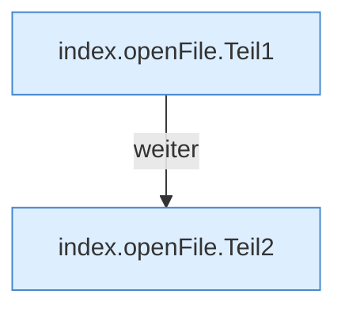

[[00 Start]] › [[Dashboard-UI]] › [[Legacy-Dateien]] › [[index.openFile]]

# index.openFile

`index.openFile(p)` [src/main/resources/web/index.html:141–142](https://github.com/Sciddie/minecraft-serverhoster-plugin/blob/95b02b953b0b4c23673e900e021a7c3c844aa37d/src/main/resources/web/index.html#L141-L142)

- `openFile` in `src/main/resources/web/index.html`
