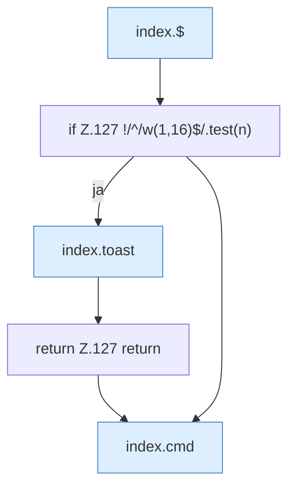

[[00 Start]] › [[Dashboard-UI]] › [[Legacy-Altlast]] › [[index.pc]]

# index.pc

`index.pc(c)` [src/main/resources/web/index.html:127–127](https://github.com/Sciddie/minecraft-serverhoster-plugin/blob/95b02b953b0b4c23673e900e021a7c3c844aa37d/src/main/resources/web/index.html#L127-L127)



```knoten
index.$
  Sucht auf der älteren [[Glossar#Bedienseite|Bedienseite]] ein einzelnes Element. Im [[Glossar#Quelltext|Quelltext]] heißt das `$`.
if Z.127 !/^/w(1,16)$/.test(n)
  Hier fällt eine Entscheidung. Nur wenn sie zutrifft, geht es den Ja-Weg weiter. Das steht in [[Glossar#Zeile|Zeile]] 127.
index.toast
  Zeigt in der älteren [[Glossar#Bedienseite|Bedienseite]] einen kurzen Hinweis. Im [[Glossar#Quelltext|Quelltext]] heißt das `toast`.
return Z.127 return
  Hier endet die [[Glossar#Funktion|Funktion]] und liefert ein Ergebnis zurück. Das steht in [[Glossar#Zeile|Zeile]] 127.
index.cmd
  Schickt einen [[Glossar#Befehl|Befehl]] aus der älteren [[Glossar#Bedienseite|Bedienseite]] an den [[Glossar#Spielserver|Spielserver]]. Im [[Glossar#Quelltext|Quelltext]] heißt das `cmd`.
```

> [!knoten]- Was die Blöcke tun
> - **index.$**: Sucht auf der älteren [[Glossar#Bedienseite|Bedienseite]] ein einzelnes Element. Im [[Glossar#Quelltext|Quelltext]] heißt das `$`.
> - **if Z.127 !/^/w(1,16)$/.test(n)**: Hier fällt eine Entscheidung. Nur wenn sie zutrifft, geht es den Ja-Weg weiter. Das steht in [[Glossar#Zeile|Zeile]] 127.
> - **index.toast**: Zeigt in der älteren [[Glossar#Bedienseite|Bedienseite]] einen kurzen Hinweis. Im [[Glossar#Quelltext|Quelltext]] heißt das `toast`.
> - **return Z.127 return**: Hier endet die [[Glossar#Funktion|Funktion]] und liefert ein Ergebnis zurück. Das steht in [[Glossar#Zeile|Zeile]] 127.
> - **index.cmd**: Schickt einen [[Glossar#Befehl|Befehl]] aus der älteren [[Glossar#Bedienseite|Bedienseite]] an den [[Glossar#Spielserver|Spielserver]]. Im [[Glossar#Quelltext|Quelltext]] heißt das `cmd`.

- Schickt von der älteren [[Glossar#Bedienseite|Bedienseite]] einen [[Glossar#Befehl|Befehl]], der einen [[Glossar#Spieler|Spieler]] betrifft.
