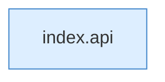

[[00 Start]] › [[Dashboard-UI]] › [[Legacy-Sitzung]] › [[index.post]]

# index.post

`index.post(p, body, raw)` [src/main/resources/web/index.html:82–82](https://github.com/Sciddie/minecraft-serverhoster-plugin/blob/95b02b953b0b4c23673e900e021a7c3c844aa37d/src/main/resources/web/index.html#L82-L82)

- `post` in `src/main/resources/web/index.html`
