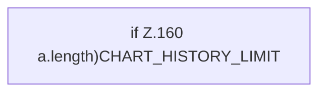

[[00 Start]] › [[Dashboard-UI]] › [[Legacy-Status]] › [[index.pushChartValue]]

# index.pushChartValue

`index.pushChartValue(key, value)` [src/main/resources/web/index.html:160–160](https://github.com/Sciddie/minecraft-serverhoster-plugin/blob/95b02b953b0b4c23673e900e021a7c3c844aa37d/src/main/resources/web/index.html#L160-L160)

- `pushChartValue` in `src/main/resources/web/index.html`
