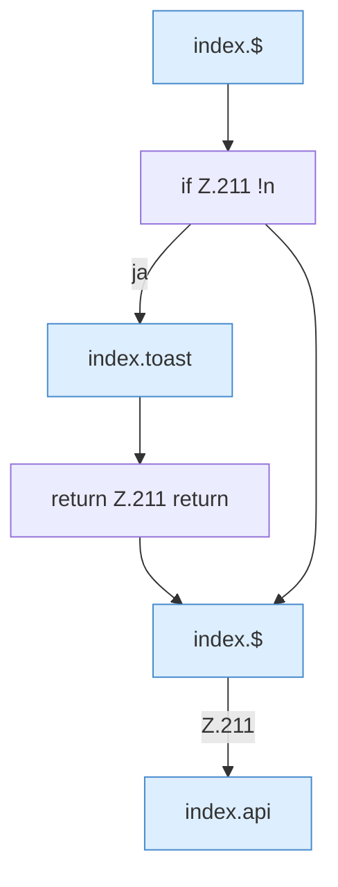

[[00 Start]] › [[Dashboard-UI]] › [[Legacy-Diag]] › [[index.readCrash]]

# index.readCrash

`index.readCrash()` [src/main/resources/web/index.html:211–211](https://github.com/Sciddie/minecraft-serverhoster-plugin/blob/95b02b953b0b4c23673e900e021a7c3c844aa37d/src/main/resources/web/index.html#L211-L211)



```knoten
index.$
  `$` in `index.html`.
if Z.211 !n
  Zeile 211: prüft `!n`.
index.toast
  Zeigt eine Meldung `toast`. Ruft `$`.
return Z.211 return
  Zeile 211: Rückgabe `return`.
index.api
  Sendet einen Dashboard-Request `api`. Ruft `scoped`, `showLogin`, `toast`.
```

- `readCrash` in `src/main/resources/web/index.html`
