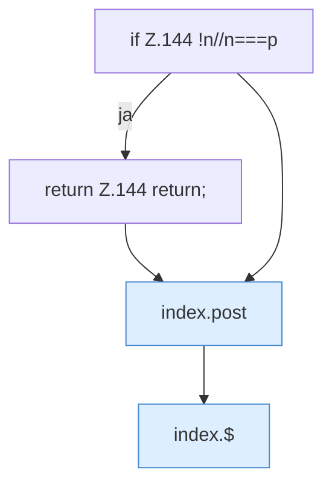

[[00 Start]] › [[Dashboard-UI]] › [[Legacy-Dateien]] › [[index.ren]] › [[index.ren.Teil1]]

# index.ren.Teil1



```knoten
if Z.144 !n//n===p
  Zeile 144: prüft `!n//n===p`.
return Z.144 return;
  Zeile 144: Rückgabe `return;`.
index.post
  Schickt von der älteren [[Glossar#Bedienseite|Bedienseite]] einen Auftrag, der etwas ändert. Sendet POST `post`. Ruft `api`.
index.$
  Sucht auf der älteren [[Glossar#Bedienseite|Bedienseite]] ein einzelnes Element. `$` in `index.html`.
```

> [!knoten]- Was die Blöcke tun
> - **if Z.144 !n//n===p**: Zeile 144: prüft `!n//n===p`.
> - **return Z.144 return;**: Zeile 144: Rückgabe `return;`.
> - **index.post**: Schickt von der älteren [[Glossar#Bedienseite|Bedienseite]] einen Auftrag, der etwas ändert. Sendet POST `post`. Ruft `api`.
> - **index.$**: Sucht auf der älteren [[Glossar#Bedienseite|Bedienseite]] ein einzelnes Element. `$` in `index.html`.

- Ein weiterer Abschnitt derselben Übersicht.
- Fortsetzung von `index.ren`.
