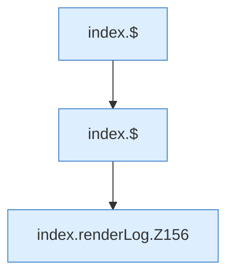

[[00 Start]] › [[Dashboard-UI]] › [[Legacy-Logs]] › [[index.renderLog]]

# index.renderLog

`index.renderLog()` [src/main/resources/web/index.html:155–156](https://github.com/Sciddie/minecraft-serverhoster-plugin/blob/95b02b953b0b4c23673e900e021a7c3c844aa37d/src/main/resources/web/index.html#L155-L156)



```knoten
index.$
  Sucht auf der älteren [[Glossar#Bedienseite|Bedienseite]] ein einzelnes Element. Im [[Glossar#Quelltext|Quelltext]] heißt das `$`.
index.renderLog.Z156
  Der Ablauf geht in [[Glossar#Zeile|Zeile]] 156 weiter. Eine Ebene tiefer steht er genauer. Im [[Glossar#Quelltext|Quelltext]] heißt das `Z156`.
```

> [!knoten]- Was die Blöcke tun
> - **index.$**: Sucht auf der älteren [[Glossar#Bedienseite|Bedienseite]] ein einzelnes Element. Im [[Glossar#Quelltext|Quelltext]] heißt das `$`.
> - **index.renderLog.Z156**: Der Ablauf geht in [[Glossar#Zeile|Zeile]] 156 weiter. Eine Ebene tiefer steht er genauer. Im [[Glossar#Quelltext|Quelltext]] heißt das `Z156`.

- Die ältere [[Glossar#Bedienseite|Bedienseite]] zeichnet das Protokoll.
