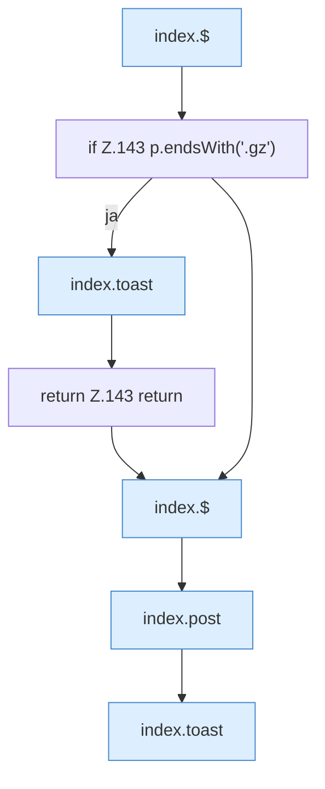

[[00 Start]] › [[Dashboard-UI]] › [[Legacy-Dateien]] › [[index.saveFile]] › [[index.saveFile.Teil1]]

# index.saveFile.Teil1



```knoten
index.$
  `$` in `index.html`.
if Z.143 p.endsWith('.gz')
  Zeile 143: prüft `p.endsWith('.gz')`.
index.toast
  Zeigt eine Meldung `toast`. Ruft `$`.
return Z.143 return
  Zeile 143: Rückgabe `return`.
index.post
  Sendet POST `post`. Ruft `api`.
```

- Fortsetzung von `index.saveFile`, Quellreihenfolge.
