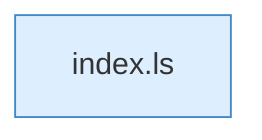

[[00 Start]] › [[Dashboard-UI]] › [[Legacy-Dateien]] › [[index.saveFile]] › [[index.saveFile.Teil2]]

# index.saveFile.Teil2



```knoten
index.ls
  Listet das Verzeichnis `ls`. Ruft `api`, `esc`, `jp`.
```

- Fortsetzung von `index.saveFile`, Quellreihenfolge.
