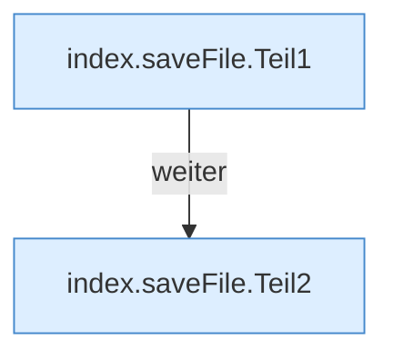

[[00 Start]] › [[Dashboard-UI]] › [[Legacy-Dateien]] › [[index.saveFile]]

# index.saveFile

`index.saveFile()` [src/main/resources/web/index.html:143–143](https://github.com/Sciddie/minecraft-serverhoster-plugin/blob/95b02b953b0b4c23673e900e021a7c3c844aa37d/src/main/resources/web/index.html#L143-L143)



```knoten
index.saveFile.Teil1
  Abschnitt 1 dieses Ablaufs, in Quellreihenfolge.
index.saveFile.Teil2
  Abschnitt 2 dieses Ablaufs, in Quellreihenfolge.
```

- `saveFile` in `src/main/resources/web/index.html`
