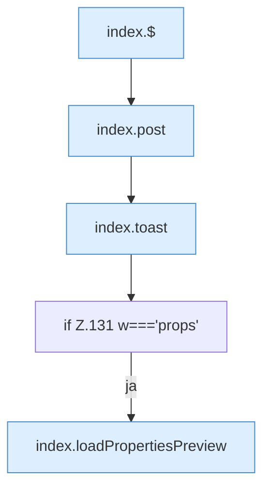

[[00 Start]] › [[Dashboard-UI]] › [[Legacy-Dateien]] › [[index.saveTxt]]

# index.saveTxt

`index.saveTxt(w)` [src/main/resources/web/index.html:131–131](https://github.com/Sciddie/minecraft-serverhoster-plugin/blob/95b02b953b0b4c23673e900e021a7c3c844aa37d/src/main/resources/web/index.html#L131-L131)



```knoten
index.$
  Sucht auf der älteren [[Glossar#Bedienseite|Bedienseite]] ein einzelnes Element. Im [[Glossar#Quelltext|Quelltext]] heißt das `$`.
index.post
  Schickt von der älteren [[Glossar#Bedienseite|Bedienseite]] einen Auftrag, der etwas ändert. Im [[Glossar#Quelltext|Quelltext]] heißt das `post`.
index.toast
  Zeigt in der älteren [[Glossar#Bedienseite|Bedienseite]] einen kurzen Hinweis. Im [[Glossar#Quelltext|Quelltext]] heißt das `toast`.
if Z.131 w==='props'
  Hier fällt eine Entscheidung. Nur wenn sie zutrifft, geht es den Ja-Weg weiter. Das steht in [[Glossar#Zeile|Zeile]] 131.
index.loadPropertiesPreview
  Die ältere [[Glossar#Bedienseite|Bedienseite]] lädt die Eigenschaften die Vorschau. Im [[Glossar#Quelltext|Quelltext]] heißt das `loadPropertiesPreview`.
```

> [!knoten]- Was die Blöcke tun
> - **index.$**: Sucht auf der älteren [[Glossar#Bedienseite|Bedienseite]] ein einzelnes Element. Im [[Glossar#Quelltext|Quelltext]] heißt das `$`.
> - **index.post**: Schickt von der älteren [[Glossar#Bedienseite|Bedienseite]] einen Auftrag, der etwas ändert. Im [[Glossar#Quelltext|Quelltext]] heißt das `post`.
> - **index.toast**: Zeigt in der älteren [[Glossar#Bedienseite|Bedienseite]] einen kurzen Hinweis. Im [[Glossar#Quelltext|Quelltext]] heißt das `toast`.
> - **if Z.131 w==='props'**: Hier fällt eine Entscheidung. Nur wenn sie zutrifft, geht es den Ja-Weg weiter. Das steht in [[Glossar#Zeile|Zeile]] 131.
> - **index.loadPropertiesPreview**: Die ältere [[Glossar#Bedienseite|Bedienseite]] lädt die Eigenschaften die Vorschau. Im [[Glossar#Quelltext|Quelltext]] heißt das `loadPropertiesPreview`.

- Die ältere [[Glossar#Bedienseite|Bedienseite]] speichert den Text.
