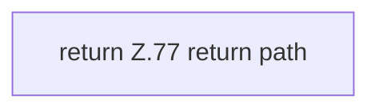

[[00 Start]] › [[Dashboard-UI]] › [[Legacy-Sitzung]] › [[index.scoped]]

# index.scoped

`index.scoped(path)` [src/main/resources/web/index.html:77–77](https://github.com/Sciddie/minecraft-serverhoster-plugin/blob/95b02b953b0b4c23673e900e021a7c3c844aa37d/src/main/resources/web/index.html#L77-L77)



```knoten
return Z.77 return path
  Zeile 77: Rückgabe `return path`.
```

- Gibt `path` unverändert zurück.
- Befund: Altlast, sicher. index.html:77 return path
