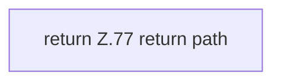

[[00 Start]] › [[Dashboard-UI]] › [[Legacy-Sitzung]] › [[index.scoped]]

# index.scoped

`index.scoped(path)` [src/main/resources/web/index.html:77–77](https://github.com/Sciddie/minecraft-serverhoster-plugin/blob/95b02b953b0b4c23673e900e021a7c3c844aa37d/src/main/resources/web/index.html#L77-L77)



```knoten
return Z.77 return path
  Hier endet die [[Glossar#Funktion|Funktion]] und liefert ein Ergebnis zurück. Das steht in [[Glossar#Zeile|Zeile]] 77.
```

> [!knoten]- Was die Blöcke tun
> - **return Z.77 return path**: Hier endet die [[Glossar#Funktion|Funktion]] und liefert ein Ergebnis zurück. Das steht in [[Glossar#Zeile|Zeile]] 77.

- Gibt einen Dateipfad unverändert zurück. Der Name klingt nach einer Prüfung, es ist aber keine.
- Auffällig: ein alter Weg läuft noch mit. Das nennt man [[Glossar#Altlast|Altlast]].
