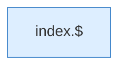

[[00 Start]] › [[Dashboard-UI]] › [[Legacy-Konsole]] › [[index.scrollCon]]

# index.scrollCon

`index.scrollCon()` [src/main/resources/web/index.html:122–122](https://github.com/Sciddie/minecraft-serverhoster-plugin/blob/95b02b953b0b4c23673e900e021a7c3c844aa37d/src/main/resources/web/index.html#L122-L122)



```knoten
index.$
  Sucht auf der älteren [[Glossar#Bedienseite|Bedienseite]] ein einzelnes Element. Im [[Glossar#Quelltext|Quelltext]] heißt das `$`.
```

> [!knoten]- Was die Blöcke tun
> - **index.$**: Sucht auf der älteren [[Glossar#Bedienseite|Bedienseite]] ein einzelnes Element. Im [[Glossar#Quelltext|Quelltext]] heißt das `$`.

- Die ältere [[Glossar#Bedienseite|Bedienseite]] rollt die [[Glossar#Konsole|Konsole]].
