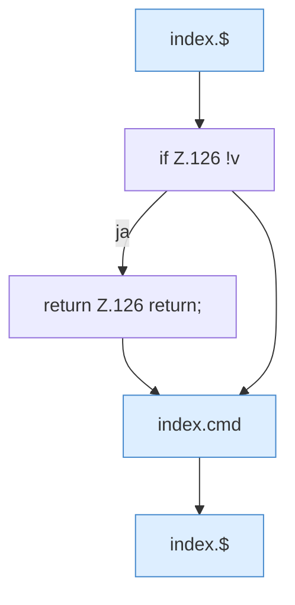

[[00 Start]] › [[Dashboard-UI]] › [[Legacy-Konsole]] › [[index.sendCmd]]

# index.sendCmd

`index.sendCmd()` [src/main/resources/web/index.html:126–126](https://github.com/Sciddie/minecraft-serverhoster-plugin/blob/95b02b953b0b4c23673e900e021a7c3c844aa37d/src/main/resources/web/index.html#L126-L126)



```knoten
index.$
  Sucht auf der älteren [[Glossar#Bedienseite|Bedienseite]] ein einzelnes Element. Im [[Glossar#Quelltext|Quelltext]] heißt das `$`.
if Z.126 !v
  Hier fällt eine Entscheidung. Nur wenn sie zutrifft, geht es den Ja-Weg weiter. Das steht in [[Glossar#Zeile|Zeile]] 126.
return Z.126 return;
  Hier endet die [[Glossar#Funktion|Funktion]] und liefert ein Ergebnis zurück. Das steht in [[Glossar#Zeile|Zeile]] 126.
index.cmd
  Schickt einen [[Glossar#Befehl|Befehl]] aus der älteren [[Glossar#Bedienseite|Bedienseite]] an den [[Glossar#Spielserver|Spielserver]]. Im [[Glossar#Quelltext|Quelltext]] heißt das `cmd`.
```

> [!knoten]- Was die Blöcke tun
> - **index.$**: Sucht auf der älteren [[Glossar#Bedienseite|Bedienseite]] ein einzelnes Element. Im [[Glossar#Quelltext|Quelltext]] heißt das `$`.
> - **if Z.126 !v**: Hier fällt eine Entscheidung. Nur wenn sie zutrifft, geht es den Ja-Weg weiter. Das steht in [[Glossar#Zeile|Zeile]] 126.
> - **return Z.126 return;**: Hier endet die [[Glossar#Funktion|Funktion]] und liefert ein Ergebnis zurück. Das steht in [[Glossar#Zeile|Zeile]] 126.
> - **index.cmd**: Schickt einen [[Glossar#Befehl|Befehl]] aus der älteren [[Glossar#Bedienseite|Bedienseite]] an den [[Glossar#Spielserver|Spielserver]]. Im [[Glossar#Quelltext|Quelltext]] heißt das `cmd`.

- Die ältere [[Glossar#Bedienseite|Bedienseite]] schickt einen [[Glossar#Befehl|Befehl]].
