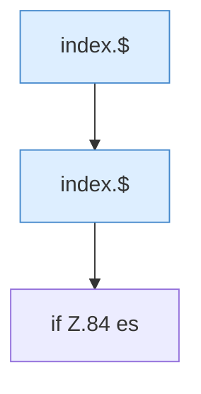

[[00 Start]] › [[Dashboard-UI]] › [[Legacy-Sitzung]] › [[index.showLogin]]

# index.showLogin

`index.showLogin()` [src/main/resources/web/index.html:84–84](https://github.com/Sciddie/minecraft-serverhoster-plugin/blob/95b02b953b0b4c23673e900e021a7c3c844aa37d/src/main/resources/web/index.html#L84-L84)



```knoten
index.$
  `$` in `index.html`.
if Z.84 es
  Zeile 84: prüft `es`.
```

- `showLogin` in `src/main/resources/web/index.html`
