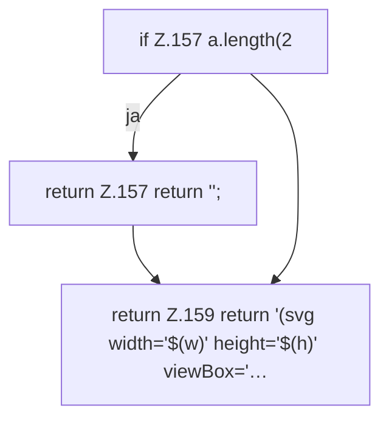

[[00 Start]] › [[Dashboard-UI]] › [[Legacy-Status]] › [[index.spark]]

# index.spark

`index.spark(vals)` [src/main/resources/web/index.html:157–159](https://github.com/Sciddie/minecraft-serverhoster-plugin/blob/95b02b953b0b4c23673e900e021a7c3c844aa37d/src/main/resources/web/index.html#L157-L159)



```knoten
if Z.157 a.length(2
  Hier fällt eine Entscheidung. Nur wenn sie zutrifft, geht es den Ja-Weg weiter. Das steht in [[Glossar#Zeile|Zeile]] 157.
return Z.157 return '';
  Hier endet die [[Glossar#Funktion|Funktion]] und liefert ein Ergebnis zurück. Das steht in [[Glossar#Zeile|Zeile]] 157.
return Z.159 return '(svg width='$(w)' height='$(h)' viewBox='…
  Hier endet die [[Glossar#Funktion|Funktion]] und liefert ein Ergebnis zurück. Das steht in [[Glossar#Zeile|Zeile]] 159.
```

> [!knoten]- Was die Blöcke tun
> - **if Z.157 a.length(2**: Hier fällt eine Entscheidung. Nur wenn sie zutrifft, geht es den Ja-Weg weiter. Das steht in [[Glossar#Zeile|Zeile]] 157.
> - **return Z.157 return '';**: Hier endet die [[Glossar#Funktion|Funktion]] und liefert ein Ergebnis zurück. Das steht in [[Glossar#Zeile|Zeile]] 157.
> - **return Z.159 return '(svg width='$(w)' height='$(h)' viewBox='…**: Hier endet die [[Glossar#Funktion|Funktion]] und liefert ein Ergebnis zurück. Das steht in [[Glossar#Zeile|Zeile]] 159.

- Zeichnet in der älteren [[Glossar#Bedienseite|Bedienseite]] eine kleine Kurve der letzten Messwerte.
