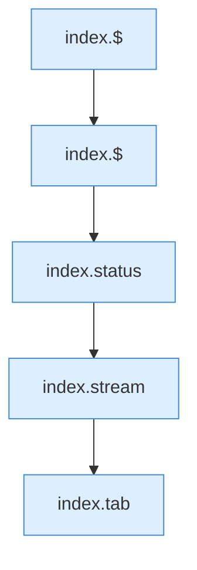
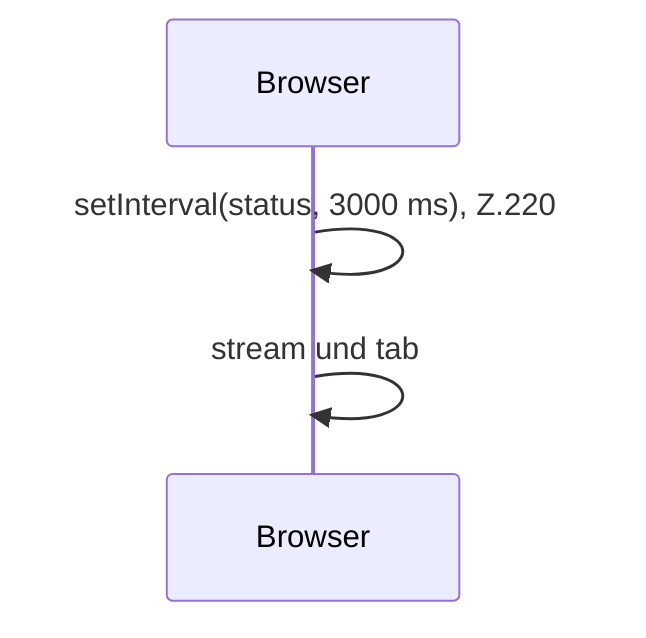

[[00 Start]] › [[Dashboard-UI]] › [[Legacy-Sitzung]] › [[index.start]]

# index.start

`index.start()` [src/main/resources/web/index.html:220–220](https://github.com/Sciddie/minecraft-serverhoster-plugin/blob/95b02b953b0b4c23673e900e021a7c3c844aa37d/src/main/resources/web/index.html#L220-L220)



```knoten
index.$
  Sucht auf der älteren [[Glossar#Bedienseite|Bedienseite]] ein einzelnes Element. Im [[Glossar#Quelltext|Quelltext]] heißt das `$`.
index.status
  Holt den Zustand und zeichnet ihn in die ältere [[Glossar#Bedienseite|Bedienseite]]. Im [[Glossar#Quelltext|Quelltext]] heißt das `status`.
index.stream
  Hält die Verbindung offen, damit neue Konsolenzeilen von selbst nachkommen. Im [[Glossar#Quelltext|Quelltext]] heißt das `stream`.
index.tab
  Wechselt in der älteren [[Glossar#Bedienseite|Bedienseite]] den sichtbaren Bereich. Im [[Glossar#Quelltext|Quelltext]] heißt das `tab`.
```

> [!knoten]- Was die Blöcke tun
> - **index.$**: Sucht auf der älteren [[Glossar#Bedienseite|Bedienseite]] ein einzelnes Element. Im [[Glossar#Quelltext|Quelltext]] heißt das `$`.
> - **index.status**: Holt den Zustand und zeichnet ihn in die ältere [[Glossar#Bedienseite|Bedienseite]]. Im [[Glossar#Quelltext|Quelltext]] heißt das `status`.
> - **index.stream**: Hält die Verbindung offen, damit neue Konsolenzeilen von selbst nachkommen. Im [[Glossar#Quelltext|Quelltext]] heißt das `stream`.
> - **index.tab**: Wechselt in der älteren [[Glossar#Bedienseite|Bedienseite]] den sichtbaren Bereich. Im [[Glossar#Quelltext|Quelltext]] heißt das `tab`.



- Die ältere [[Glossar#Bedienseite|Bedienseite]] fragt ab jetzt alle drei Sekunden nach dem Zustand.
- Auffällig: derselbe Teil ist zweimal vorhanden. Das nennt man [[Glossar#Doppelt gebaut|Doppelt gebaut]].
