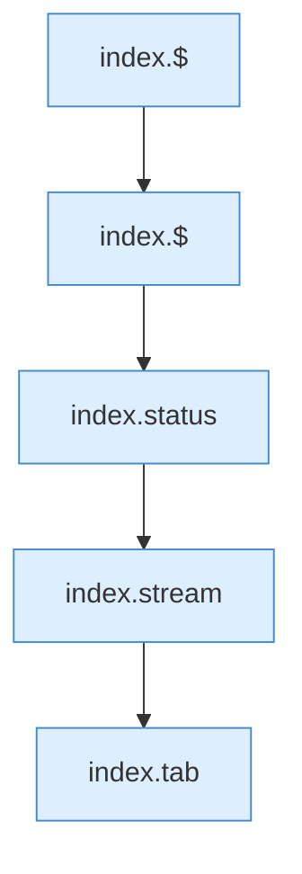
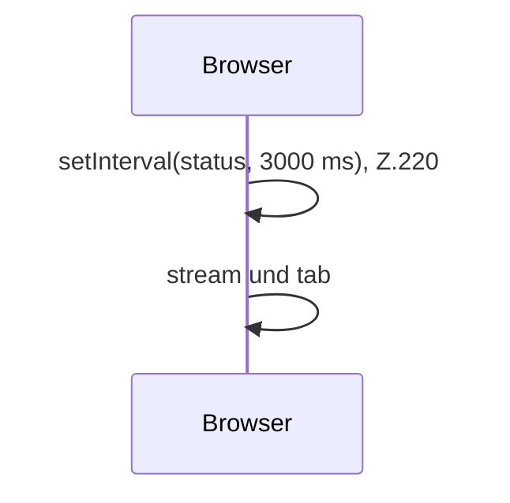

[[00 Start]] › [[Dashboard-UI]] › [[Legacy-Sitzung]] › [[index.start]]

# index.start

`index.start()` [src/main/resources/web/index.html:220–220](https://github.com/Sciddie/minecraft-serverhoster-plugin/blob/95b02b953b0b4c23673e900e021a7c3c844aa37d/src/main/resources/web/index.html#L220-L220)



```knoten
index.$
  `$` in `index.html`.
index.status
  Liefert den Status `status`. Ruft `api`, `updateChildActions`, `$`.
index.stream
  Hält den Strom offen `stream`. Ruft `$`, `addLine`, `api`.
index.tab
  Wechselt den Tab `tab`. Ruft `$`, `loadTxt`, `loadPropertiesPreview`.
```



- Browser-Timer 3000 ms für `status`.
- Befund: doppelte Implementierung, sicher. index.html:220 setInterval 3000 ms läuft in der React-Hülle weiter
