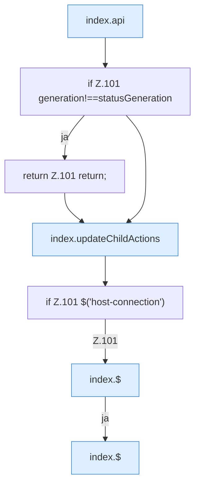

[[00 Start]] › [[Dashboard-UI]] › [[Legacy-Status]] › [[index.status]] › [[index.status.Z101.Teil1]]

# index.status.Z101.Teil1



```knoten
index.api
  Sendet einen Dashboard-Request `api`. Ruft `scoped`, `showLogin`, `toast`.
if Z.101 generation!==statusGeneration
  Zeile 101: prüft `generation!==statusGeneration`.
return Z.101 return;
  Zeile 101: Rückgabe `return;`.
index.updateChildActions
  Aktualisiert `updateChildActions`. Ruft `$`.
if Z.101 $('host-connection')
  Zeile 101: prüft `$('host-connection')`.
index.$
  `$` in `index.html`.
```

- Fortsetzung von `index.status.Z101`, Quellreihenfolge.
