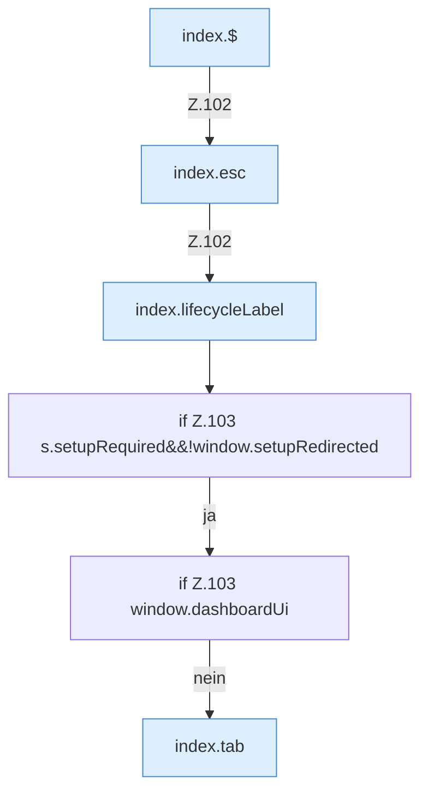

[[00 Start]] › [[Dashboard-UI]] › [[Legacy-Status]] › [[index.status]] › [[index.status.Z101.Teil2]]

# index.status.Z101.Teil2



```knoten
index.$
  `$` in `index.html`.
index.esc
  Maskiert HTML `esc`.
index.lifecycleLabel
  `lifecycleLabel` in `index.html`.
if Z.103 s.setupRequired&&!window.setupRedirected
  Zeile 103: prüft `s.setupRequired&&!window.setupRedirected`.
if Z.103 window.dashboardUi
  Zeile 103: prüft `window.dashboardUi`.
index.tab
  Wechselt den Tab `tab`. Ruft `$`, `loadTxt`, `loadPropertiesPreview`.
```

- Fortsetzung von `index.status.Z101`, Quellreihenfolge.
