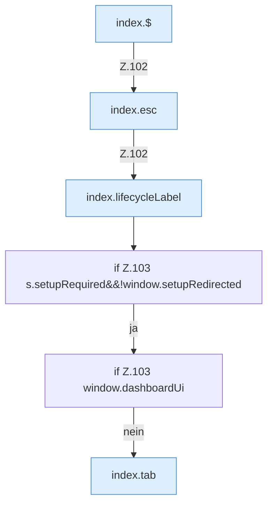

[[00 Start]] › [[Dashboard-UI]] › [[Legacy-Status]] › [[index.status]] › [[index.status.Z101.Teil2]]

# index.status.Z101.Teil2



```knoten
index.$
  Sucht auf der älteren [[Glossar#Bedienseite|Bedienseite]] ein einzelnes Element. `$` in `index.html`.
index.esc
  Macht einen Text so ungefährlich, dass die Seite ihn anzeigen kann. Maskiert HTML `esc`.
index.lifecycleLabel
  Setzt die Beschriftung, die den Zustand in der älteren [[Glossar#Bedienseite|Bedienseite]] zeigt. `lifecycleLabel` in `index.html`.
if Z.103 s.setupRequired&&!window.setupRedirected
  Zeile 103: prüft `s.setupRequired&&!window.setupRedirected`.
if Z.103 window.dashboardUi
  Zeile 103: prüft `window.dashboardUi`.
index.tab
  Wechselt in der älteren [[Glossar#Bedienseite|Bedienseite]] den sichtbaren Bereich. Wechselt den Tab `tab`. Ruft `$`, `loadTxt`, `loadPropertiesPreview`.
```

> [!knoten]- Was die Blöcke tun
> - **index.$**: Sucht auf der älteren [[Glossar#Bedienseite|Bedienseite]] ein einzelnes Element. `$` in `index.html`.
> - **index.esc**: Macht einen Text so ungefährlich, dass die Seite ihn anzeigen kann. Maskiert HTML `esc`.
> - **index.lifecycleLabel**: Setzt die Beschriftung, die den Zustand in der älteren [[Glossar#Bedienseite|Bedienseite]] zeigt. `lifecycleLabel` in `index.html`.
> - **if Z.103 s.setupRequired&&!window.setupRedirected**: Zeile 103: prüft `s.setupRequired&&!window.setupRedirected`.
> - **if Z.103 window.dashboardUi**: Zeile 103: prüft `window.dashboardUi`.
> - **index.tab**: Wechselt in der älteren [[Glossar#Bedienseite|Bedienseite]] den sichtbaren Bereich. Wechselt den Tab `tab`. Ruft `$`, `loadTxt`, `loadPropertiesPreview`.

- Ein weiterer Abschnitt derselben Übersicht.
- Fortsetzung von `index.status.Z101`.
