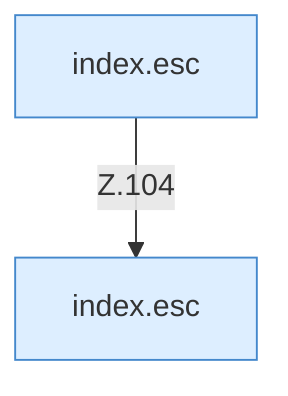

[[00 Start]] › [[Dashboard-UI]] › [[Legacy-Status]] › [[index.status]] › [[index.status.Z101.Teil3.Calls104.2]]

# index.status.Z101.Teil3.Calls104.2

- Fortsetzung von `index.status.Z101.Teil3`, Quellreihenfolge.
