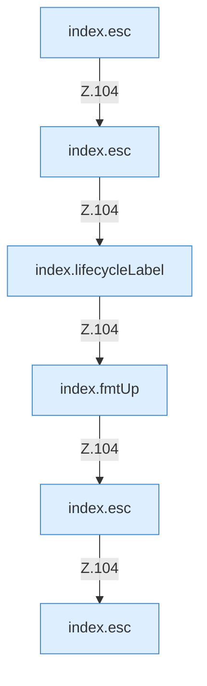

[[00 Start]] › [[Dashboard-UI]] › [[Legacy-Status]] › [[index.status]] › [[index.status.Z101.Teil3.Calls104]]

# index.status.Z101.Teil3.Calls104



```knoten
index.esc
  Maskiert HTML `esc`.
index.lifecycleLabel
  `lifecycleLabel` in `index.html`.
index.fmtUp
  Formatiert `fmtUp`.
```

- Fortsetzung von `index.status.Z101.Teil3`, Quellreihenfolge.
