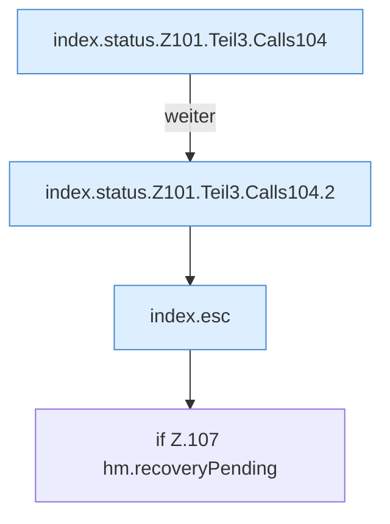

[[00 Start]] › [[Dashboard-UI]] › [[Legacy-Status]] › [[index.status]] › [[index.status.Z101.Teil3]]

# index.status.Z101.Teil3



```knoten
index.status.Z101.Teil3.Calls104
  Weitere eigene Aufrufe ab Zeile 104.
index.status.Z101.Teil3.Calls104.2
  Seite `index.status.Z101.Teil3.Calls104.2`.
index.esc
  Maskiert HTML `esc`.
if Z.107 hm.recoveryPending
  Zeile 107: prüft `hm.recoveryPending`.
```

- Fortsetzung von `index.status.Z101`, Quellreihenfolge.
