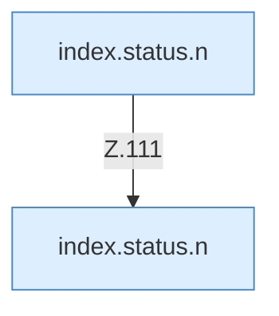

[[00 Start]] › [[Dashboard-UI]] › [[Legacy-Status]] › [[index.status]] › [[index.status.Z101.Teil4.Calls111.3]]

# index.status.Z101.Teil4.Calls111.3



```knoten
index.status.n
  Die ältere [[Glossar#Bedienseite|Bedienseite]] macht hier einen einzelnen Schritt. Eine Ebene tiefer steht er genauer. `n` in `index.html`.
```

> [!knoten]- Was die Blöcke tun
> - **index.status.n**: Die ältere [[Glossar#Bedienseite|Bedienseite]] macht hier einen einzelnen Schritt. Eine Ebene tiefer steht er genauer. `n` in `index.html`.

- Ein [[Glossar#Kapitel|Kapitel]] in dieser Übersicht.
- Fortsetzung von `index.status.Z101.Teil4`.
