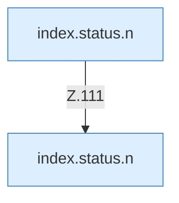

[[00 Start]] › [[Dashboard-UI]] › [[Legacy-Status]] › [[index.status]] › [[index.status.Z101.Teil4.Calls111.3]]

# index.status.Z101.Teil4.Calls111.3

- Fortsetzung von `index.status.Z101.Teil4`, Quellreihenfolge.
