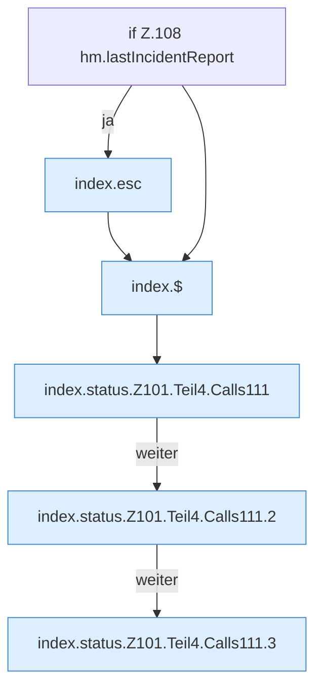

[[00 Start]] › [[Dashboard-UI]] › [[Legacy-Status]] › [[index.status]] › [[index.status.Z101.Teil4]]

# index.status.Z101.Teil4



```knoten
if Z.108 hm.lastIncidentReport
  Zeile 108: prüft `hm.lastIncidentReport`.
index.esc
  Maskiert HTML `esc`.
index.$
  `$` in `index.html`.
index.status.Z101.Teil4.Calls111
  Weitere eigene Aufrufe ab Zeile 111.
index.status.Z101.Teil4.Calls111.2
  Seite `index.status.Z101.Teil4.Calls111.2`.
index.status.Z101.Teil4.Calls111.3
  Seite `index.status.Z101.Teil4.Calls111.3`.
```

- Fortsetzung von `index.status.Z101`, Quellreihenfolge.
