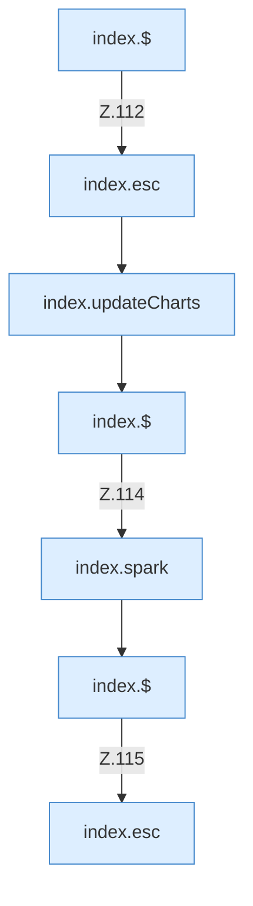

[[00 Start]] › [[Dashboard-UI]] › [[Legacy-Status]] › [[index.status]] › [[index.status.Z101.Teil5]]

# index.status.Z101.Teil5



```knoten
index.$
  Sucht auf der älteren [[Glossar#Bedienseite|Bedienseite]] ein einzelnes Element. `$` in `index.html`.
index.esc
  Macht einen Text so ungefährlich, dass die Seite ihn anzeigen kann. Maskiert HTML `esc`.
index.updateCharts
  Die ältere [[Glossar#Bedienseite|Bedienseite]] ändert die Kurven. Aktualisiert `updateCharts`. Ruft `pushChartValue`, `$`, `chartCard`.
index.spark
  Zeichnet in der älteren [[Glossar#Bedienseite|Bedienseite]] eine kleine Kurve der letzten Messwerte. Zeichnet eine Sparkline `spark`.
```

> [!knoten]- Was die Blöcke tun
> - **index.$**: Sucht auf der älteren [[Glossar#Bedienseite|Bedienseite]] ein einzelnes Element. `$` in `index.html`.
> - **index.esc**: Macht einen Text so ungefährlich, dass die Seite ihn anzeigen kann. Maskiert HTML `esc`.
> - **index.updateCharts**: Die ältere [[Glossar#Bedienseite|Bedienseite]] ändert die Kurven. Aktualisiert `updateCharts`. Ruft `pushChartValue`, `$`, `chartCard`.
> - **index.spark**: Zeichnet in der älteren [[Glossar#Bedienseite|Bedienseite]] eine kleine Kurve der letzten Messwerte. Zeichnet eine Sparkline `spark`.

- Ein weiterer Abschnitt derselben Übersicht.
- Fortsetzung von `index.status.Z101`.
