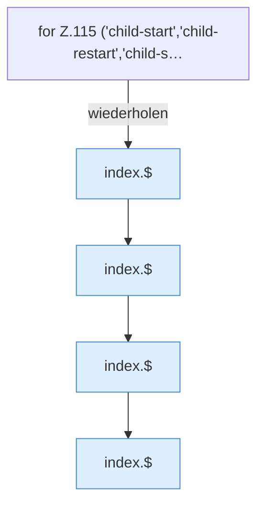

[[00 Start]] › [[Dashboard-UI]] › [[Legacy-Status]] › [[index.status]] › [[index.status.Z101.Z115.Teil1]]

# index.status.Z101.Z115.Teil1



```knoten
for Z.115 ('child-start','child-restart','child-s…
  Zeile 115: Schleife `('child-start','child-restart','child-s…`.
index.$
  Sucht auf der älteren [[Glossar#Bedienseite|Bedienseite]] ein einzelnes Element. `$` in `index.html`.
```

> [!knoten]- Was die Blöcke tun
> - **for Z.115 ('child-start','child-restart','child-s…**: Zeile 115: Schleife `('child-start','child-restart','child-s…`.
> - **index.$**: Sucht auf der älteren [[Glossar#Bedienseite|Bedienseite]] ein einzelnes Element. `$` in `index.html`.

- Ein weiterer Abschnitt derselben Übersicht.
- Fortsetzung von `index.status.Z101.Z115`.
