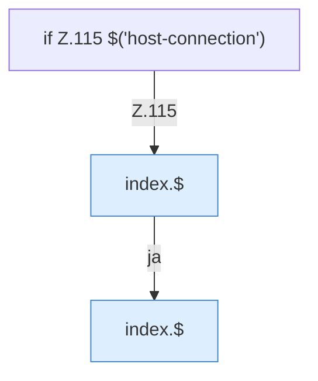

[[00 Start]] › [[Dashboard-UI]] › [[Legacy-Status]] › [[index.status]] › [[index.status.Z101.Z115.Teil2]]

# index.status.Z101.Z115.Teil2



```knoten
if Z.115 $('host-connection')
  Zeile 115: prüft `$('host-connection')`.
index.$
  Sucht auf der älteren [[Glossar#Bedienseite|Bedienseite]] ein einzelnes Element. `$` in `index.html`.
```

> [!knoten]- Was die Blöcke tun
> - **if Z.115 $('host-connection')**: Zeile 115: prüft `$('host-connection')`.
> - **index.$**: Sucht auf der älteren [[Glossar#Bedienseite|Bedienseite]] ein einzelnes Element. `$` in `index.html`.

- Ein weiterer Abschnitt derselben Übersicht.
- Fortsetzung von `index.status.Z101.Z115`.
