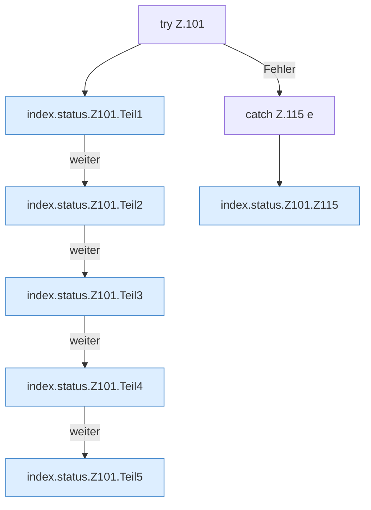

[[00 Start]] › [[Dashboard-UI]] › [[Legacy-Status]] › [[index.status]] › [[index.status.Z101]]

# index.status.Z101



```knoten
try Z.101
  Zeile 101: Versuch. Der Fehlerpfad geht in catch.
index.status.Z101.Teil1
  Abschnitt 1 dieses Ablaufs, in Quellreihenfolge.
index.status.Z101.Teil2
  Abschnitt 2 dieses Ablaufs, in Quellreihenfolge.
index.status.Z101.Teil3
  Abschnitt 3 dieses Ablaufs, in Quellreihenfolge.
index.status.Z101.Teil4
  Abschnitt 4 dieses Ablaufs, in Quellreihenfolge.
index.status.Z101.Teil5
  Abschnitt 5 dieses Ablaufs, in Quellreihenfolge.
catch Z.115 e
  Zeile 115: fängt e.
index.status.Z101.Z115
  Fortsetzung des Ablaufs ab Zeile 115.
```

- Fortsetzung von `index.status`, Quellreihenfolge.
