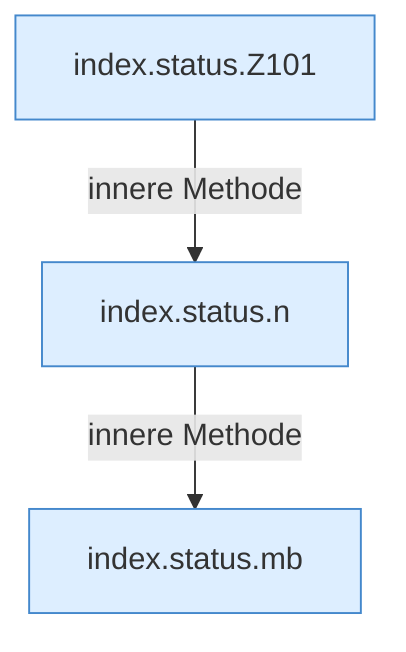

[[00 Start]] › [[Dashboard-UI]] › [[Legacy-Status]] › [[index.status]]

# index.status

`index.status()` [src/main/resources/web/index.html:101–115](https://github.com/Sciddie/minecraft-serverhoster-plugin/blob/95b02b953b0b4c23673e900e021a7c3c844aa37d/src/main/resources/web/index.html#L101-L115)



```knoten
index.status.Z101
  Fortsetzung des Ablaufs ab Zeile 101.
index.status.n
  `n` in `index.html`.
index.status.mb
  `mb` in `index.html`. Ruft `n`.
```

- `status` in `src/main/resources/web/index.html`
