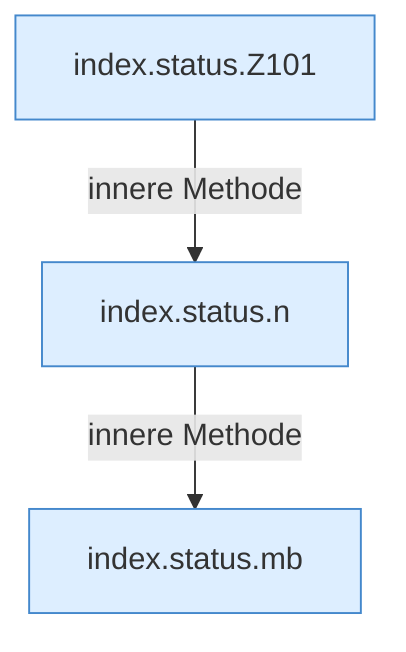

[[00 Start]] › [[Dashboard-UI]] › [[Legacy-Status]] › [[index.status]]

# index.status

`index.status()` [src/main/resources/web/index.html:101–115](https://github.com/Sciddie/minecraft-serverhoster-plugin/blob/95b02b953b0b4c23673e900e021a7c3c844aa37d/src/main/resources/web/index.html#L101-L115)



```knoten
index.status.Z101
  Der Ablauf geht in [[Glossar#Zeile|Zeile]] 101 weiter. Eine Ebene tiefer steht er genauer. Im [[Glossar#Quelltext|Quelltext]] heißt das `Z101`.
index.status.n
  Die ältere [[Glossar#Bedienseite|Bedienseite]] macht hier einen einzelnen Schritt. Eine Ebene tiefer steht er genauer. Im [[Glossar#Quelltext|Quelltext]] heißt das `n`.
index.status.mb
  Die ältere [[Glossar#Bedienseite|Bedienseite]] macht hier einen einzelnen Schritt. Eine Ebene tiefer steht er genauer. Im [[Glossar#Quelltext|Quelltext]] heißt das `mb`.
```

> [!knoten]- Was die Blöcke tun
> - **index.status.Z101**: Der Ablauf geht in [[Glossar#Zeile|Zeile]] 101 weiter. Eine Ebene tiefer steht er genauer. Im [[Glossar#Quelltext|Quelltext]] heißt das `Z101`.
> - **index.status.n**: Die ältere [[Glossar#Bedienseite|Bedienseite]] macht hier einen einzelnen Schritt. Eine Ebene tiefer steht er genauer. Im [[Glossar#Quelltext|Quelltext]] heißt das `n`.
> - **index.status.mb**: Die ältere [[Glossar#Bedienseite|Bedienseite]] macht hier einen einzelnen Schritt. Eine Ebene tiefer steht er genauer. Im [[Glossar#Quelltext|Quelltext]] heißt das `mb`.

- Holt den Zustand und zeichnet ihn in die ältere [[Glossar#Bedienseite|Bedienseite]].
