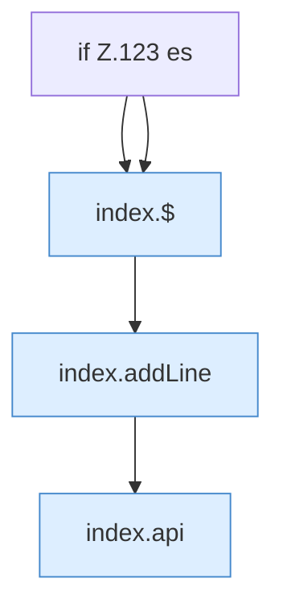

[[00 Start]] › [[Dashboard-UI]] › [[Legacy-Konsole]] › [[index.stream]]

# index.stream

`index.stream()` [src/main/resources/web/index.html:123–124](https://github.com/Sciddie/minecraft-serverhoster-plugin/blob/95b02b953b0b4c23673e900e021a7c3c844aa37d/src/main/resources/web/index.html#L123-L124)



```knoten
if Z.123 es
  Zeile 123: prüft `es`.
index.$
  `$` in `index.html`.
index.addLine
  Fügt hinzu `addLine`. Ruft `$`, `cls`.
index.api
  Sendet einen Dashboard-Request `api`. Ruft `scoped`, `showLogin`, `toast`.
```

- `stream` in `src/main/resources/web/index.html`
