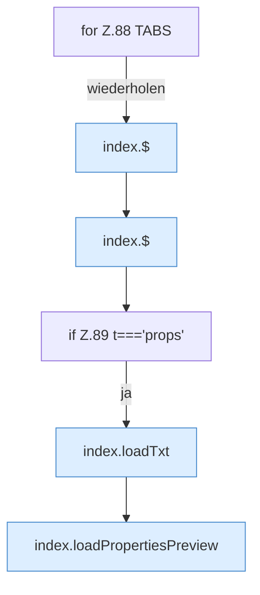

[[00 Start]] › [[Dashboard-UI]] › [[Legacy-Sitzung]] › [[index.tab]] › [[index.tab.Teil1]]

# index.tab.Teil1



```knoten
for Z.88 TABS
  Zeile 88: Schleife `TABS`.
index.$
  `$` in `index.html`.
if Z.89 t==='props'
  Zeile 89: prüft `t==='props'`.
index.loadTxt
  Lädt `loadTxt`. Ruft `api`, `$`.
index.loadPropertiesPreview
  Lädt `loadPropertiesPreview`. Ruft `api`, `$`, `esc`.
```

- Fortsetzung von `index.tab`, Quellreihenfolge.
