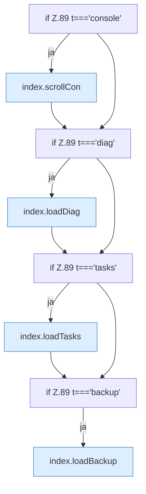

[[00 Start]] › [[Dashboard-UI]] › [[Legacy-Sitzung]] › [[index.tab]] › [[index.tab.Teil3]]

# index.tab.Teil3



```knoten
if Z.89 t==='console'
  Zeile 89: prüft `t==='console'`.
index.scrollCon
  Die ältere [[Glossar#Bedienseite|Bedienseite]] rollt die [[Glossar#Konsole|Konsole]]. Scrollt die Konsole `scrollCon`. Ruft `$`.
if Z.89 t==='diag'
  Zeile 89: prüft `t==='diag'`.
index.loadDiag
  Die ältere [[Glossar#Bedienseite|Bedienseite]] lädt die [[Glossar#Diagnose|Diagnose]]. Lädt `loadDiag`. Ruft `api`, `$`, `row`.
if Z.89 t==='tasks'
  Zeile 89: prüft `t==='tasks'`.
index.loadTasks
  Die ältere [[Glossar#Bedienseite|Bedienseite]] lädt die [[Glossar#Aufgabe|Aufgaben]]. Lädt `loadTasks`. Ruft `api`, `$`, `esc`.
if Z.89 t==='backup'
  Zeile 89: prüft `t==='backup'`.
index.loadBackup
  Die ältere [[Glossar#Bedienseite|Bedienseite]] lädt die [[Glossar#Sicherungskopie|Sicherungskopie]]. Lädt `loadBackup`. Ruft `api`, `$`, `esc`.
```

> [!knoten]- Was die Blöcke tun
> - **if Z.89 t==='console'**: Zeile 89: prüft `t==='console'`.
> - **index.scrollCon**: Die ältere [[Glossar#Bedienseite|Bedienseite]] rollt die [[Glossar#Konsole|Konsole]]. Scrollt die Konsole `scrollCon`. Ruft `$`.
> - **if Z.89 t==='diag'**: Zeile 89: prüft `t==='diag'`.
> - **index.loadDiag**: Die ältere [[Glossar#Bedienseite|Bedienseite]] lädt die [[Glossar#Diagnose|Diagnose]]. Lädt `loadDiag`. Ruft `api`, `$`, `row`.
> - **if Z.89 t==='tasks'**: Zeile 89: prüft `t==='tasks'`.
> - **index.loadTasks**: Die ältere [[Glossar#Bedienseite|Bedienseite]] lädt die [[Glossar#Aufgabe|Aufgaben]]. Lädt `loadTasks`. Ruft `api`, `$`, `esc`.
> - **if Z.89 t==='backup'**: Zeile 89: prüft `t==='backup'`.
> - **index.loadBackup**: Die ältere [[Glossar#Bedienseite|Bedienseite]] lädt die [[Glossar#Sicherungskopie|Sicherungskopie]]. Lädt `loadBackup`. Ruft `api`, `$`, `esc`.

- Ein weiterer Abschnitt derselben Übersicht.
- Fortsetzung von `index.tab`.
