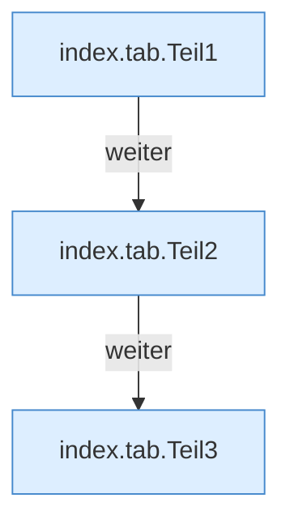

[[00 Start]] › [[Dashboard-UI]] › [[Legacy-Sitzung]] › [[index.tab]]

# index.tab

`index.tab(t)` [src/main/resources/web/index.html:88–89](https://github.com/Sciddie/minecraft-serverhoster-plugin/blob/95b02b953b0b4c23673e900e021a7c3c844aa37d/src/main/resources/web/index.html#L88-L89)



```knoten
index.tab.Teil1
  Abschnitt 1 dieses Ablaufs, in Quellreihenfolge.
index.tab.Teil2
  Abschnitt 2 dieses Ablaufs, in Quellreihenfolge.
index.tab.Teil3
  Abschnitt 3 dieses Ablaufs, in Quellreihenfolge.
```

- `tab` in `src/main/resources/web/index.html`
