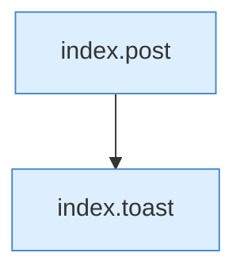

[[00 Start]] › [[Dashboard-UI]] › [[Legacy-Altlast]] › [[index.testBackup]]

# index.testBackup

`index.testBackup()` [src/main/resources/web/index.html:219–219](https://github.com/Sciddie/minecraft-serverhoster-plugin/blob/95b02b953b0b4c23673e900e021a7c3c844aa37d/src/main/resources/web/index.html#L219-L219)

- `testBackup` in `src/main/resources/web/index.html`
