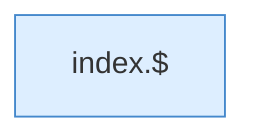

[[00 Start]] › [[Dashboard-UI]] › [[Legacy-Sitzung]] › [[index.toast]]

# index.toast

`index.toast(m, bad)` [src/main/resources/web/index.html:76–76](https://github.com/Sciddie/minecraft-serverhoster-plugin/blob/95b02b953b0b4c23673e900e021a7c3c844aa37d/src/main/resources/web/index.html#L76-L76)

- `toast` in `src/main/resources/web/index.html`
